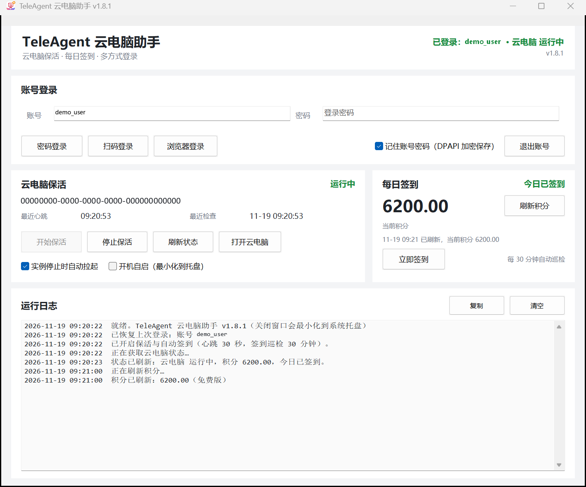

# TeleAgent 云电脑助手（TeleAgentHelper）

> Windows 桌面端 · 云电脑保活 / 每日签到 / 一键打开云电脑
>
> 基于 [uvwt/CtyunHelper](https://github.com/uvwt/CtyunHelper) 的深度二次开发
>
> **账号说明：本程序使用 [www.teleai.com.cn](https://www.teleai.com.cn/) 的登录账号和密码（与网页端同一套），不是 TeleAgent 平台的账号密码；两者不互通，请勿使用 TeleAgent 账号登录。**



## 简介

TeleAgentHelper 是一个面向 Windows 的 TeleAgent 云电脑辅助工具：登录后自动保持云电脑在线、每天领取登录积分，并且可以一键打开云电脑桌面。

程序为单文件 exe，双击即可运行，不需要安装运行环境；关闭窗口后驻留系统托盘。

## 功能

- **三种登录方式**：账号密码登录（自动完成滑块验证）、扫码登录（程序内直接显示二维码）、浏览器登录（兜底）。
- **云电脑保活**：每 30 秒发送一次管理面心跳；实例停止且勾选「实例停止时自动拉起」时，自动发起启动。
- **自动签到**：每 30 分钟巡检每日登录积分，未领取自动领取，已领取只刷新余额。
- **打开云电脑**：申请一次性连接票据并用系统默认浏览器打开云电脑页面；实例未运行时先启动并等待就绪。
- **登录态自动续期**：剩余不到 48 小时自动 token-refresh；失效时优先用本地保存的账号密码重新登录（含滑块），继续保活与签到。
- **手动刷新**：「刷新状态」并发拉取账号、签到与实例信息；积分旁有「刷新积分」按钮，只刷新余额。
- **桌面体验**：浅色卡片布局、状态色、积分大字、运行日志区、窗口位置与大小记忆、托盘常驻、开机自启、单实例运行。
- **关于页面**：右上角「关于」或托盘菜单打开，包含项目地址、上游项目、免责声明与许可证说明。
- **命令行版本**：提供登录、状态查询、签到、保活、实例操作与常驻 daemon。

## 下载与运行

从 [Releases](../../releases/latest) 下载最新的 `TeleAgentHelper-v*.exe`，双击运行即可，无需安装。

首次使用：

1. 填写 TeleAgent 账号和密码，点「密码登录」；或点「扫码登录」用天翼账号 App 扫码；或点「浏览器登录」在浏览器中完成登录。
2. 登录成功后程序自动开始保活与签到，并立即刷新云电脑状态。
3. 需要进入桌面时点「打开云电脑」；程序会在默认浏览器中打开云电脑页面。
4. 关闭主窗口只会最小化到托盘；要彻底退出，请从托盘菜单选择「退出」。

## 登录方式

### 账号密码登录

- 账号密码为 [www.teleai.com.cn](https://www.teleai.com.cn/) 的统一登录账号，不是 TeleAgent 平台账号。
- 自动识别并求解滑块验证码，成功后保存会话。
- 账号密码使用 Windows DPAPI 加密保存在本机，可勾选「记住账号密码」。
- 服务端会累计密码错误次数，连续错误可能触发风控，请确认密码后再试。

### 扫码登录

- 点「扫码登录」后，程序直接向天翼账号接口申请二维码并在窗口内显示，不需要打开浏览器。
- 用天翼账号 App（小翼管家 / 天翼云盘 / 微信）扫码并在手机上确认。
- 二维码 4 分钟有效，过期自动刷新。

### 浏览器登录

- 点「浏览器登录」会启动一个浏览器窗口，在窗口中自行扫码或输入账号密码。
- 登录完成后程序自动接管登录态，适合扫码接口不可用或密码被服务端拒绝时兜底。
- 依赖本机安装 Edge 或 Chrome，首次启动约 5～15 秒。

## 保活与签到

- 心跳间隔 30 秒，与网页端行为一致。
- 实例状态缓存 5 分钟，避免每次心跳都拉取实例列表。
- 实例停止时自动拉起，启动冷却 5 分钟，失败按 30 秒 → 1 分钟 → 2 分钟 → 4 分钟 → 最长 5 分钟退避。
- 签到巡检每 30 分钟一次；当前只对账号下的第一个云电脑保活，可在代码中通过 `KeepaliveOptions.InstanceID` 指定实例。
- 登录态每 30 分钟检查一次，剩余不到 48 小时才续期；续期成功后立即写回本地会话。
- 程序必须保持运行才能保活；它不会阻止 Windows 休眠。

## 命令行版本

仓库同时提供命令行版本，适合服务器或无 GUI 环境：

```powershell
.\dist\teleagent.exe status
.\dist\teleagent.exe login --password -u 账号 -p 密码
.\dist\teleagent.exe login --qr
.\dist\teleagent.exe signin
.\dist\teleagent.exe daemon
```

常用命令：`login`、`status`、`refresh`、`signin`、`keepalive`、`daemon`、`install`、`uninstall`、`instance`、`logout`。

## 数据与日志

| 内容 | 位置 |
| --- | --- |
| 登录会话 | `%LOCALAPPDATA%\CtyunHelper\teleagent-session` |
| 账号密码 | `%LOCALAPPDATA%\CtyunHelper\teleagent-credential`（Windows DPAPI 加密） |
| GUI 运行日志 | `%LOCALAPPDATA%\CtyunHelper\logs\teleagent-gui.log` |
| 命令行日志 | `%LOCALAPPDATA%\CtyunHelper\logs\teleagent.log` |

「退出账号」会同时删除会话与保存的账号密码。

## 从源码构建

环境要求：Windows 10/11、Go 1.25+（构建脚本在本机 Go 版本低于 `go.mod` 声明时会自动复制到临时目录降级构建）。

```powershell
# 构建 GUI（输出 dist\TeleAgentHelper-v<版本>.exe）
.\scripts\build-teleagent-gui-windows.ps1

# 运行测试
go test ./...
go vet ./...

# 构建命令行版本
go build -trimpath -ldflags "-s -w" -o dist\teleagent.exe ./cmd/teleagent
```

构建脚本会从 `cmd/teleagent-gui/main_windows.go` 读取 `appVersion` 作为版本号，并调用 `scripts/embed-icon-windows.ps1` 嵌入图标与 manifest。

如果本机已有 TeleAgentHelper 正在运行，请先退出再构建，否则图标嵌入会因 exe 被占用失败（`EndUpdateResource failed. Win32=5`）。

## 项目结构

```text
cmd/
  teleagent-gui/       Windows GUI（walk/Win32 原生控件）
  teleagent/           命令行版本
  ctyun-helper/        原 CtyunHelper 程序入口
internal/
  teleagent/           TeleAgent 登录、验证码、保活、签到、续期协议
  app/                 原 CtyunHelper 的应用编排
  ctyun/               原 CtyunHelper 的天翼云电脑协议
  automation/          原 CtyunHelper 的自动化任务
  winui/               walk GUI 壳层与资源
  storage/             凭据与会话存储（DPAPI）
  logging/             日志与脱敏
docs/
  teleagent-gui.md     TeleAgentHelper 详细文档
  ctyunhelper.md       原 CtyunHelper 说明
  screenshot.png       当前版本界面截图
scripts/               Windows 构建与资源嵌入脚本
```

## 与上游 CtyunHelper 的关系

本项目最初基于 [uvwt/CtyunHelper](https://github.com/uvwt/CtyunHelper) v0.1.5 的工程结构、walk GUI 壳层、日志与凭据存储等基础模块进行二次开发；原 CtyunHelper 的 `internal/app`、`internal/ctyun`、`internal/automation` 等仍保留在仓库中。

TeleAgent 相关的协议实现、GUI 界面、CLI 与本文档为新增实现。原项目说明见 [docs/ctyunhelper.md](docs/ctyunhelper.md)。

## 已知限制

- 只对账号下的第一个云电脑保活；如需指定实例，请在 `KeepaliveOptions.InstanceID` 传入实例 ID。
- 协议常量来自对 TeleAgent 前端的逆向分析，TeleAgent 前端升级后可能需要同步调整。
- 打开云电脑拿到的连接地址带有一次性 token，仅对本次连接有效，请不要转发。
- 浏览器登录依赖 Edge 或 Chrome。
- 密码错误会累计服务端 `errCount`，连续错误会触发风控提示，请勿反复试错。
- 本项目为非官方辅助工具，与 TeleAgent、中国电信不存在隶属、授权或背书关系。

## 文档

- [TeleAgentHelper 详细文档](docs/teleagent-gui.md)
- [更新记录](CHANGELOG.md)
- [来源与授权说明](NOTICE.md)
- [第三方组件声明](THIRD_PARTY_NOTICES.md)

## 授权与声明

本仓库新增的 TeleAgent 实现与文档采用 [MIT License](LICENSE)，该许可仅覆盖 [LICENSE](LICENSE) 中列明的原创部分。来自 [uvwt/CtyunHelper](https://github.com/uvwt/CtyunHelper) 的代码权利归其原作者所有；上游仓库当前没有提供 LICENSE 文件，相关代码保留其原有权利状态。完整说明见 [NOTICE.md](NOTICE.md)。
