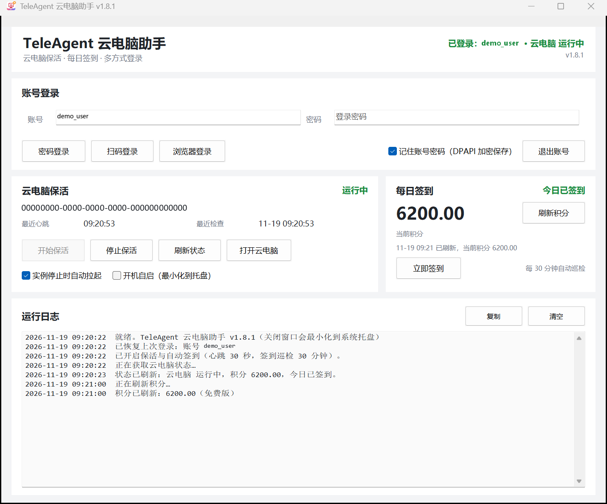
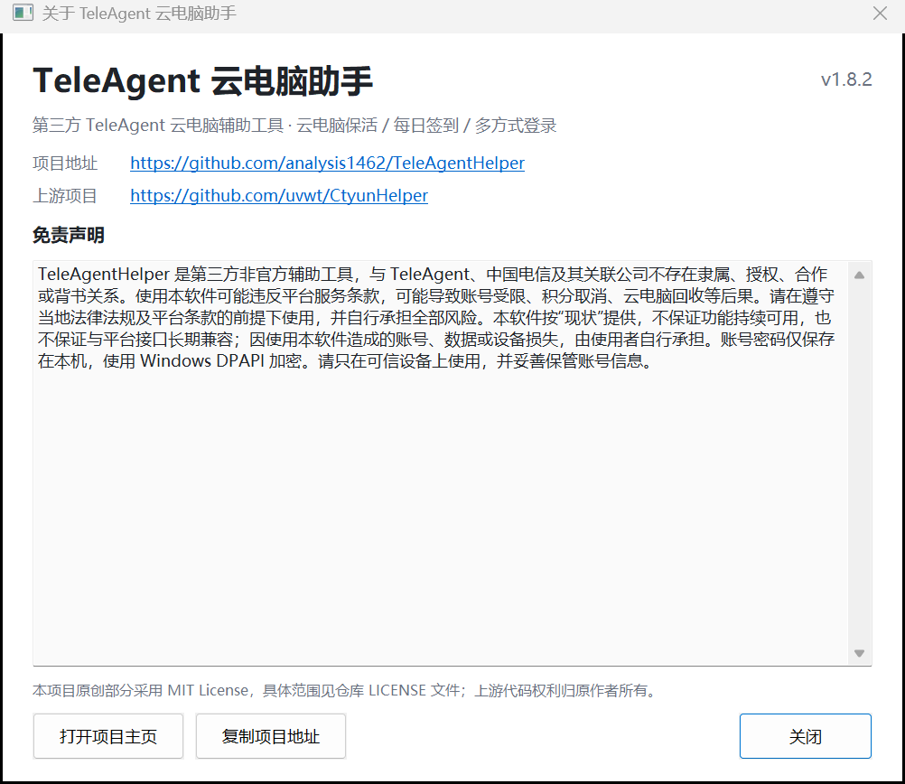

# TeleAgent 云电脑助手（TeleAgentHelper）

把 [TeleAgent](https://agent.teleai.com.cn/teleagent) 的登录、云电脑保活和每日签到做成了一个可双击运行的 Windows 桌面程序。界面与 CtyunHelper 一致（walk/Win32 原生控件），程序文件为 `dist\TeleAgentHelper-v1.8.2.exe`。

> **账号说明：登录使用 [www.teleai.com.cn](https://www.teleai.com.cn/) 的账号密码（与网页端同一套），不是 TeleAgent 平台的账号密码；两者不互通，请勿使用 TeleAgent 账号登录。**



## 功能

- **三种登录方式**：
  - 账号密码登录：自动识别并完成滑块验证，成功后本地保存会话与账号密码。
  - 扫码登录：点「扫码登录」直接弹出二维码窗口（二维码由程序用天翼账号接口实时生成，不需要浏览器），用天翼账号 App（小翼管家 / 天翼云盘 / 微信）扫码并在手机上确认，程序自动完成票据换会话。二维码 4 分钟有效，过期会在窗口里自动刷新；也可以点「刷新二维码」手动换一张。
  - 浏览器登录：点「浏览器登录」打开一个浏览器窗口，在里面自行扫码或用账号密码登录，程序自动接管登录态。**扫码接口不可用、或密码被服务端拒绝时的兜底**。
- **云电脑保活**：每 30 秒一次心跳；实例处于停止状态且勾选「实例停止时自动拉起」时会自动发起启动。
- **打开云电脑**：点「打开云电脑」会向 TeleAgent 申请一个桌面连接地址（`https://pc.ctyun.cn/#/fullview?token=…`）并用系统默认浏览器打开，等同于在网页端点「云电脑」。云电脑处于停止状态时，按钮会先发起启动并最多等待约 90 秒再打开。
- **自动签到**：每 30 分钟巡检一次每日登录积分，未领取就领取，已领取只刷新积分。积分旁边有「刷新积分」按钮，只调用积分中心接口，点一下就能单独刷新余额，不等待实例和签到查询。
- **手动刷新有回显**：点「刷新状态」会在运行日志里写「正在刷新状态…」，完成后写「刷新完成：云电脑 运行中，积分 6200.00，今日已签到。」；任一接口失败会逐项写明原因，并补一句「刷新完成（部分失败）」。刷新期间按钮会置灰，防止重复点击。
- **登录后自动刷新**：登录成功立即并发拉取账号、签到与实例状态，状态栏先显示「正在获取云电脑状态…」，完成后显示「已登录：账号 · 云电脑 运行中」，日志写一行汇总，不需要再手动点刷新。
- **会话自动续期**：登录态剩余不到 48 小时时自动调用 token-refresh 续期并立刻落盘（每次 7 天，服务端最多允许 90 天）；云端接口报失效时也会先尝试续期，续不了再用本地保存的账号密码重新登录（含滑块），成功后继续保活与签到。
- **托盘常驻**：关闭窗口只最小化到托盘，托盘菜单可打开主界面、开始/停止保活、立即签到、退出。
- **开机自启**：勾选后写入 `HKCU\Software\Microsoft\Windows\CurrentVersion\Run`，值为 `"<exe 路径>" --startup`，开机时隐藏到托盘启动。
- **单实例**：重复双击只会提示“已经在运行”，不会出现两个保活进程。
- **关于页面**：主界面右上角「关于」链接或托盘菜单可打开；集中展示项目地址、上游项目、免责声明和许可证说明，支持打开项目主页与复制地址。



## 使用

1. 双击 `TeleAgentHelper-v1.8.2.exe`。
2. 任选一种登录：填写账号和密码后点「密码登录」（DPAPI 加密保存在本机）；或点「扫码登录」用天翼账号 App 扫窗口里的二维码；或点「浏览器登录」在浏览器里自行登录。
3. 登录成功后自动开始保活与自动签到，界面会显示云电脑实例、实例状态、最近心跳、最近检查、最近错误。
4. 想直接进桌面时点「打开云电脑」，程序会在浏览器里打开云电脑页面（先确认实例是运行中，否则会先启动再等它就绪）。
5. 需要手动补签时点「立即签到」；需要停止时点「停止保活」，或从托盘菜单选择「退出」彻底结束进程。

## 数据与日志

| 内容 | 位置 |
| --- | --- |
| 登录会话 | `%LOCALAPPDATA%\CtyunHelper\teleagent-session` |
| 账号密码 | `%LOCALAPPDATA%\CtyunHelper\teleagent-credential`（Windows DPAPI 加密） |
| 运行日志 | `%LOCALAPPDATA%\CtyunHelper\logs\teleagent-gui.log` |
| 命令行版本日志 | `%LOCALAPPDATA%\CtyunHelper\logs\teleagent.log` |

「退出账号」会同时删除会话与保存的账号密码。

## 构建

```powershell
.\scripts\build-teleagent-gui-windows.ps1
```

脚本会：

1. 从 `cmd/teleagent-gui/main_windows.go` 读取 `appVersion` 作为文件名版本号；
2. 如果本机 Go 版本低于 `go.mod` 声明，自动复制到临时目录把 `go` 行降级后再构建（不改动仓库的 `go.mod`）；
3. 产出 `dist\TeleAgentHelper-v<版本>.exe`（`-H=windowsgui -s -w`）；
4. 调用 `scripts/embed-icon-windows.ps1` 嵌入图标与 manifest。

只想验证编译：

```powershell
go build ./cmd/teleagent-gui
```

## 实现说明

- `cmd/teleagent-gui/main_windows.go`：窗口、托盘、按钮、日志，以及保活/续期/签到三个后台循环的生命周期。
- 「打开云电脑」链路：`Instances` → 未运行则 `Start` 并每 3 秒轮询 → `Connect` 取 `pc.ctyun.cn/#/fullview?token=…` → `rundll32 url.dll,FileProtocolHandler` 交给系统默认浏览器。这个 token 是 TeleAgent 的连接票据，不是账号凭据。
- `internal/teleagent/refresh.go`：登录态续期（POST /superCowork/sapi/cowork/auth/token-refresh，秒级 X-Timestamp），成功即写回本地会话；40115 表示服务端已无该会话记录，此时只记日志、token 仍可用到过期时间。
- `internal/teleagent`：协议实现。`login.go` + `captcha.go` 负责账号密码登录与滑块，`qrlogin.go` 负责扫码登录（getUUID / image / qrcodeLoginState 三个接口 + 票据换会话），`login_edge.go` / 浏览器接管负责「浏览器登录」，`keeper.go` 负责保活状态机，`signin.go` 负责签到巡检，`creds.go`/`session.go` 负责本地凭据。
- v1.8.2 新增「关于」页面：`cmd/teleagent-gui/about_windows.go` 使用 fixed-size walk Dialog 展示项目地址、上游项目、免责声明和 MIT 许可说明；入口在状态栏右侧「关于」链接与托盘菜单，支持打开项目主页和复制地址。
- v1.8.1 在积分旁增加「刷新积分」按钮：只调用 `userCenter` 接口，按钮独立置灰/恢复，不阻塞「刷新状态」和「立即签到」；登录态失效时先尝试自动续期再查一次。
- v1.8.0 界面改为浅色卡片式布局：顶部账号状态栏、登录卡、云电脑保活与每日签到双卡、底部运行日志；状态用绿/橙/红区分，积分用 20pt 大字，窗口位置和大小会记住；登录成功自动并发刷新状态（见「登录后自动刷新」）。
- v1.7.1 修复账号密码登录：网页端 `accountEncrypt` 模块加密的是密码**原文**，此前实现按 `JSON.stringify` 加了双引号，服务端解密出「"密码"」后比对失败，即使密码正确也返回 `10980039 用户名或密码不正确`。
- v1.7.0 起界面不再提供手机短信验证码登录。`smslogin.go` 保留是因为扫码登录复用了它的 189 登录基座（`s189LoginBase`/`open189LoginBase`），`smsbrowser.go` 的可见浏览器过滑块实现也没有入口了。
- 保活、续期与签到各自跑在独立 goroutine 中，遇到 `ErrSessionExpired` 时由 `runWithRelogin` 统一重新登录并继续原循环；登录失败退避 2 分钟后重试。
- 心跳与网页端一致：30 秒一次。实例状态缓存 5 分钟，避免每次心跳都拉取实例列表。
- 续期循环每 30 分钟检查一次会话剩余有效期，低于 48 小时才发起续期；续期接口对同一 token 只成功一次（成功后旧 token 的续期记录即消失，再续返回 40115 session not found），所以成功必须立即落盘。

## 已知限制

- 只对账号下的**第一个**云电脑保活；如需指定实例，可在 `KeepaliveOptions.InstanceID` 传入实例 ID。
- 浏览器兜底换票需要本机装有 Edge 或 Chrome，首次调用会启动一次无头浏览器（约 5～15 秒）。
- 密码错误会累计服务端 `errCount`，连续错误会触发风控提示，请勿反复试错。
- 「网页能登录、程序提示密码错误」：v1.7.0 及更早版本的加密明文多了 JSON 引号，属于该 bug，升级到 v1.7.1 即可；升级后仍报错才是密码本身不对。
- 扫码登录二维码由程序自绘显示（`CustomWidget` + 最近邻整数倍放大），避免系统 192dpi 缩放下被裁切；二维码 4 分钟内有效，过期会自动刷新。
- 命令行也能扫码登录：`teleagent login --qr`，二维码写到临时目录 `teleagent-qr.png`。
- 「打开云电脑」拿到的连接地址里带一次性 `token`，只对本次连接有效（失效时服务端返回 `58100 使用的token失效`），不要把整个链接转发给别人；程序只在日志里记「已在浏览器中打开云电脑」，不打印该 token。
- 打开云电脑依赖云电脑处于运行态：`POST /teleagent-manager/v1/instance/connect` 在停止态会返回 `ECPC_1000 云电脑状态不是运行状态，无法生成连接token`，程序会先启动并轮询约 90 秒，超时就提示稍后再试。
- 协议常量来自逆向，TeleAgent 前端升级后可能需要同步调整。
- 续期成功后服务端会作废旧 token 的续期记录；若新 token 落盘失败（磁盘只读等），该会话就无法再延长有效期，只能重新登录。

## 故障排查

- 双击无反应：检查是否已有同名进程（单实例），或从托盘菜单打开。
- 托盘图标不见：系统托盘溢出区里找；程序日志会记录“系统托盘不可用”。
- 保活不动：确认「最近错误」内容；`ErrSessionExpired` 会自动重登，其他错误会指数退避到最长 5 分钟。
- 日志出现「登录态无法自动续期（服务器已无该会话记录）」：说明这条会话已经续期过一次、新 token 没保存下来（例如换机或清过配置），属于正常提示，token 在显示的有效期内仍能保活；想长期自动续期就重新登录一次。
- 查看登录态到期时间：命令行 `dist\teleagent.exe status` 会打印「登录态 : 有效至 …」。
- 点「打开云电脑」报「获取连接地址失败 … ECPC_1000」：云电脑还没启动完成，等「实例状态」变成运行中再点一次；日志里会先写「云电脑当前未运行，正在发起启动…」。
- 开机自启未生效：检查注册表 `HKCU\Software\Microsoft\Windows\CurrentVersion\Run` 下是否存在 `TeleAgentHelper`。
